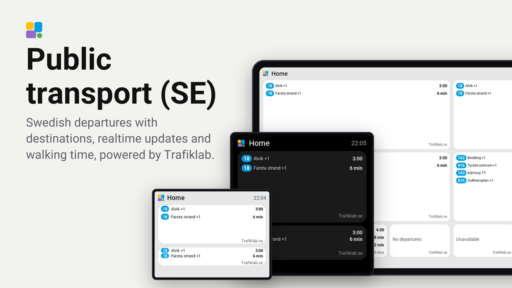

# Public transport (SE) för Tessera

[English](README.md) · [Ändringslogg](CHANGELOG.md) · [Testresultat](VALIDATION.md)

Avgångar från Trafiklab Timetables på din ESP32-skärm. Installera pluginen en gång och lägg till flera rutor med egna hållplatser och filter.
Anvisningarna gäller pluginversion **0.2.2**. Kräver plugin-API 0.12: Tessera 0.4.89 och skärmfirmware 0.57.0 eller senare kompatibel version.

## Installation

1. Registrera ett konto på https://trafiklab.se.
2. Skaffa en API-nyckel för **Trafiklab Realtime APIs** på https://developer.trafiklab.se/. En ResRobot-nyckel gäller en annan produkt.
3. Öppna Plugins i Tessera och lägg till länken https://github.com/ExhaleSthlm/tessera-plugin-sweden-public-transport.
4. Lägg till pluginen på skärmen, bygg och installera firmware. Att enbart lägga till pluginen i listan installerar inte dess kod på skärmen.
5. Ange API-nyckeln i pluginens hemliga inställning. Den ska inte ligga i Git eller YAML.
6. Lägg till två **Avgångar**-rutor. Öppna **Hållplats**, skriv minst två tecken och välj en träff direkt i sökningen. Namnet sparas med valet.
7. Under **Linjer**, lägg till 1–8 linjer från hållplatsen. Ta bort en vald linje med ×. Välj trafikslag enligt tabellen.
8. Spara och skicka layouten. Bredare rutor visar en lista, även Guition med 1×3-raster.

| Inställning | Blåsut tunnelbana | Dalens sjukhus buss |
| --- | --- | --- |
| Hållplats-ID | `740021703` | `740065542` |
| Trafikslag | Tunnelbana | Buss |
| Linjer | `18` | `163`, `816` |
| Destinationsfilter | Tomt | Tomt |

Hållplats-ID:n i tabellen är referenser; sökväljaren sparar dem åt dig.

Minst en linje måste väljas. Tar du bort alla visas **Välj linjer**, och rutan slutar begära schemalagda avgångsuppdateringar när layouten sparats. Andra rutor kan fortfarande hålla hämtningen för samma hållplats aktiv. En öppen editor kan fortfarande hämta linjealternativ. Linjerna delar samma avgångs-URL och 60-sekunderscache som hållplatsens övriga rutor.

Varje linje visas en gång i väljaren, oavsett riktning. Alternativen bygger på kommande 60 minuters avgångar och kan därför sakna linjer som inte går då. Alla trafikslag på hållplatsen ingår i linjevalen; trafikslagsfiltret styr avgångarna på skärmen. Vid byte av hållplats behöver du ta bort gamla linjeval och välja nya själv.

Tomt destinationsfilter visar båda riktningarna. Destinationen visas på varje rad. Blåsuts hållplatsområde innehåller även bussar, så välj Tunnelbana där.

## Uppgradering från 0.1.x eller 0.2.0

Uppdatera först Tessera till 0.4.89 eller en senare kompatibel version och uppdatera sedan denna plugin till 0.2.2 i Tesseras pluginvy. Från 0.1.x behöver du välja hållplats igen i den nya sökväljaren. Från både 0.1.x och 0.2.0 behöver du välja linjer igen under **Linjer**; pluginen kan inte automatiskt konvertera de gamla två linjefälten. Spara/skicka layouten och bygg om/installera skärmens firmware. Gångtid, trafikslag, destinationsfilter och förseningsinställning behåller sina fält-ID:n.

## På skärmen

- `+2` betyder två minuters försening.
- `TT` betyder tidtabellstid utan realtidsprognos.
- Gångtiden filtrerar bort avgångar du inte hinner till; nedräkningen visar tiden till avgång, inte tiden tills du behöver gå.
- Inställda avgångar visas inte. ”Inga avgångar” betyder att inga avgångar matchar valen och gångtiden i API:ets fönster på kommande 60 minuter.
- Källhänvisningen Trafiklab.se använder temats minsta textstorlek och ligger separat under avgångarna, så att alla tider ligger på samma lodräta linje.
- Vid hämtningsfel visas tidigare data med varningen ”Gamla tider”, växelvis med källhänvisningen Trafiklab.se. Båda texterna är högerställda och kan använda hela bredden under avgångarna.

Varje hållplats hämtas var 60:e sekund och delar svar mellan rutorna. Två hållplatser dygnet runt motsvarar cirka 89 280 avgångsanrop på 31 dagar, plus sökningar, omstarter och eventuella återförsök. Sökningen startar efter en kort skrivpaus och Tessera cachar sökträffar i tio minuter. [Realtime Brons](https://www.trafiklab.se/api/our-apis/trafiklab-realtime-apis/#api-key-levels) har enligt kontroll 2026-10-18 gränserna 100 000 anrop/månad och 25/minut; standarden ryms inom den kvoten för två hållplatser. Fler hållplatser eller andra appar med samma nyckel behöver räknas med.

Intervallet är tills vidare fast i manifestet. Inställbart intervall, dygnsschema och beräknad förbrukning i editorn kräver stöd utanför pluginens nuvarande manifest. Se [ROADMAP.md](ROADMAP.md).

Pluginen är en beta. Se [engelska README](README.md#requests-and-limits) för tekniska begränsningar och [VALIDATION.md](VALIDATION.md) för genomförda tester.

## Integritet

Tessera i Home Assistant skickar sökord, hållplats-ID och API-nyckel via HTTPS till Trafiklab. Nyckeln skickas som en query-parameter med Tesseras hantering av hemliga värden. Trafiklab ser även din publika IP-adress. Nyckeln skickas inte till skärmen och sparas inte i detta repo. Linje-, trafikslags- och destinationsfilter tillämpas i Tessera efter hämtning. Pluginen läser inga Home Assistant-entiteter och anropar inga HA-tjänster.

## Varför visas Trafiklab.se?

Trafiklab kräver källhänvisning på skärmar och webbwidgets som visar deras data. Därför behåller pluginen texten **Trafiklab.se** på skärmen. Se [Trafiklabs villkor för Timetables](https://www.trafiklab.se/api/our-apis/trafiklab-realtime-apis/timetables/#license). Data omfattas av [CC BY 4.0](https://creativecommons.org/licenses/by/4.0/); pluginen filtrerar och omformaterar uppgifterna till avgångar med nedräkning.

Kravet innebär inte att en hel rad måste reserveras för texten. Texten använder temats minsta textstorlek och ligger separat under avgångarna, så att alla tider ligger på samma lodräta linje. Behåll källhänvisningen om du anpassar layouten. Pluginens egen kod har MIT-licens; datans licens är separat.

## Automatiska kontroller med GitHub Actions

Arbetsflödet **Plugin CI** körs vid push och pull request och kan startas manuellt under **Actions**:

- Validerar pluginens API 0.12-manifest med validatorn i Tessera 0.4.89 (API 0.14) och kör testerna med exempeldata.
- Kompilerar C++-koden för Guition-simulatorn och kontrollerar layouten, inklusive rastret 1×3.
- Sparar bilder, loggar och rapport i **guition-preview**, som kan laddas ned från körningen i sju dagar.

Ingen API-nyckel behövs och inga Trafiklab-anrop görs. Arbetsflödet publicerar eller installerar ingenting. Simulatorbygget ersätter inte ett riktigt ESP32-bygge i Tessera eller test på din skärm. Kontrollera resultatet för aktuell commit under [GitHub Actions](https://github.com/ExhaleSthlm/tessera-plugin-sweden-public-transport/actions); lokala tester bekräftar inte att en GitHub-körning lyckats.
